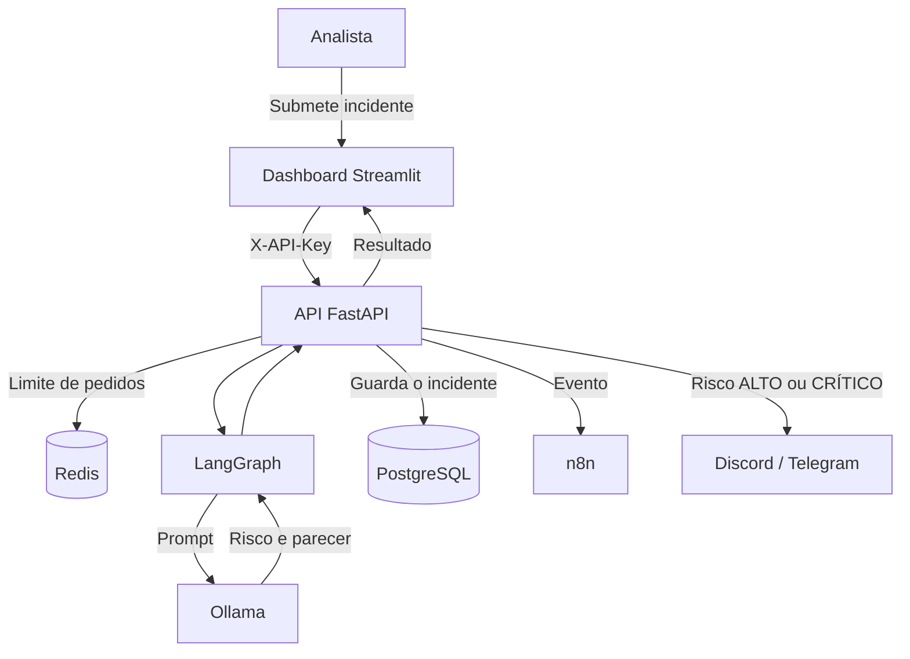
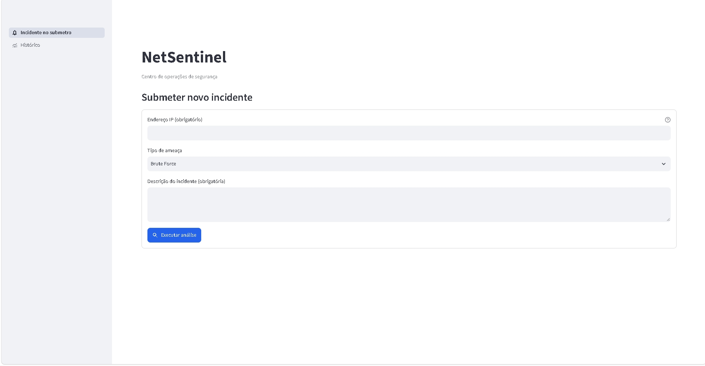
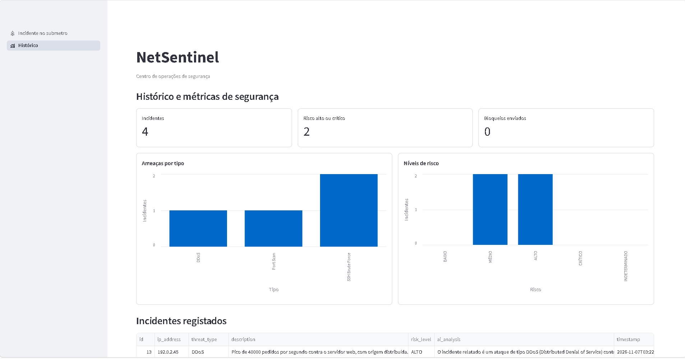
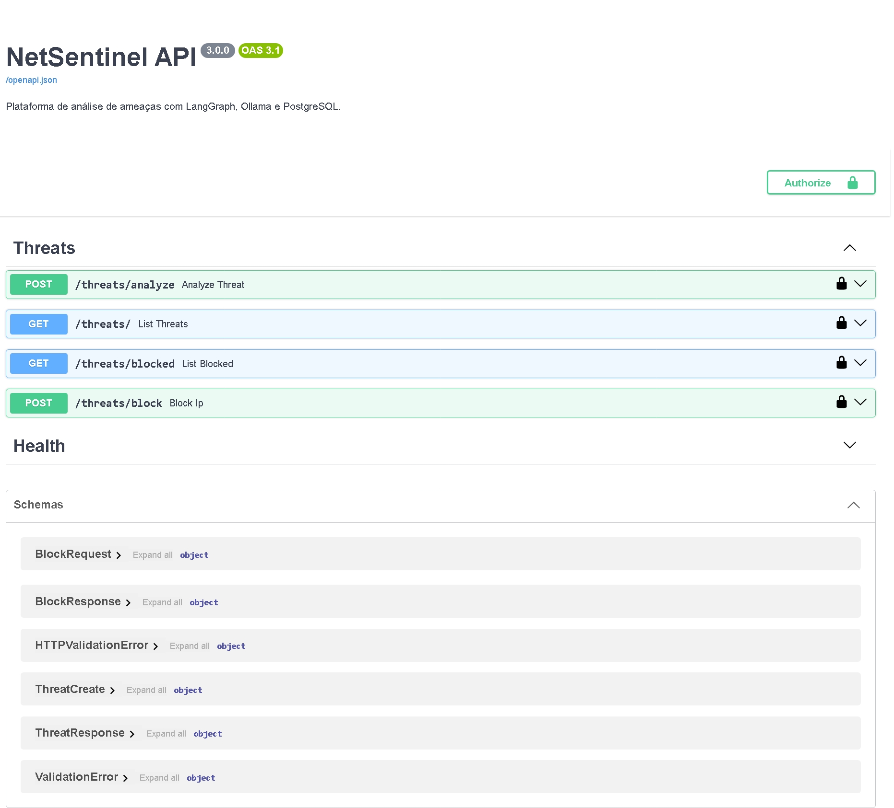

# NetSentinel

[](https://github.com/Peroba-7/netsentinel/actions/workflows/tests.yml)

Plataforma de análise de incidentes de segurança com IA local.

Um analista submete um incidente no dashboard, um modelo a correr no Ollama classifica o risco e escreve um parecer técnico, e o resultado fica guardado para consulta, relatório e resposta.

> **Projeto para uso local.** O bloqueio de IPs funciona em modo de simulação e nenhuma firewall é alterada. Leia o [aviso de segurança](#aviso-de-segurança) antes de expor qualquer serviço.

## Índice

- [Objetivo](#objetivo)
- [Funcionalidades](#funcionalidades)
- [Arquitetura](#arquitetura)
- [Fluxo de uma análise](#fluxo-de-uma-análise)
- [Painel](#painel)
- [Instalação com Docker Compose](#instalação-com-docker-compose)
- [Desenvolvimento local](#desenvolvimento-local)
- [Migrações da base de dados](#migrações-da-base-de-dados)
- [API](#api)
- [Bloqueio de IPs em modo de simulação](#bloqueio-de-ips-em-modo-de-simulação)
- [Comparação de modelos](#comparação-de-modelos)
- [Configuração](#configuração)
- [Aviso de segurança](#aviso-de-segurança)
- [Próximos passos](#próximos-passos)

## Objetivo

O NetSentinel ajuda a fazer uma primeira triagem de incidentes de segurança sem enviar dados para serviços externos de IA. O modelo corre na sua própria máquina, e a descrição dos incidentes fica na sua infraestrutura.

A classificação da IA serve de apoio à decisão e não substitui a avaliação de um analista.

## Funcionalidades

- Análise de incidentes com classificação de risco: BAIXO, MÉDIO, ALTO ou CRÍTICO
- Parecer técnico com ações recomendadas
- Histórico com métricas, gráficos e exportação para CSV
- Pedido de bloqueio de IPs em modo de simulação, permanente ou com prazo
- Alertas por n8n, Discord e Telegram
- API autenticada por chave, com limite de pedidos
- Verificação do estado dos serviços em `/health`

## Arquitetura

| Componente | Função |
|---|---|
| **Ollama** | Executa o modelo de IA localmente |
| **LangGraph** (ecossistema LangChain) | Orquestra o fluxo de análise |
| **FastAPI** | API, validação de dados e autenticação |
| **Streamlit** | Dashboard usado pelo analista |
| **PostgreSQL** | Guarda os incidentes e os IPs bloqueados |
| **Redis** | Controla o limite de pedidos por minuto |
| **n8n** | Automatiza alertas e pedidos de bloqueio |
| **Docker Compose** | Sobe e liga todos os serviços |

O projeto usa o LangGraph e o `langchain-core`, de que ele depende. A comunicação com o Ollama é feita diretamente com o cliente oficial `ollama`.

```text
app/
├── agents/graph.py      Fluxo de análise e leitura da resposta da IA
├── agents/prompt.py     Instruções, critérios de risco e exemplos dados à IA
├── api/threats.py       Rotas /threats
├── core/                Autenticação e limite de pedidos
├── db/                  Ligação à base de dados e modelos
├── schemas/             Validação de entradas e respostas
├── services/            Ollama e notificações
└── main.py              Aplicação FastAPI e /health
app_pages/               Páginas do dashboard
evals/                   Casos de avaliação da classificação de risco
migrations/              Migrações da base de dados (Alembic)
n8n/                     Workflow de bloqueio em simulação
tests/                   Testes automáticos
```

## Fluxo de uma análise



Os alertas são enviados em segundo plano, por isso uma falha no n8n, no Discord ou no Telegram não impede a análise. Se o Redis estiver indisponível, o limite de pedidos deixa de ser aplicado e a análise continua.

## Painel

O painel tem duas páginas: uma para acompanhar os incidentes e outra para submeter novos. Os dados mostrados nas imagens são fictícios.



*Histórico: métricas de segurança, gráficos por tipo e por nível de risco, e incidentes registados*



*Submissão de um novo incidente para análise pela IA*

## Instalação com Docker Compose

### Requisitos

- Docker Desktop ou Docker Engine com Docker Compose
- Cerca de 8 GB de memória disponível para o Docker com `llama3`
- Cerca de 15 GB livres em disco para as imagens e o modelo

### 1. Obter o código

```bash
git clone https://github.com/Peroba-7/netsentinel.git
cd netsentinel
```

### 2. Criar o `.env`

```bash
cp .env.example .env
```

Gere uma chave para a API:

```bash
python -c "import secrets; print(secrets.token_urlsafe(32))"
```

No `.env`, preencha pelo menos:

| Variável | Valor |
|---|---|
| `API_KEY` | A chave gerada, com um mínimo de 16 caracteres |
| `POSTGRES_PASSWORD` | Uma palavra-passe forte, só com letras e números |
| `DATABASE_URL` | Substitua `ALTERAR` pela mesma palavra-passe |

O ficheiro `.env` guarda segredos e nunca deve entrar no git.

### 3. Subir os serviços

```bash
docker compose up -d --build
```

Ao arrancar, a API aplica as [migrações da base de dados](#migrações-da-base-de-dados) antes de aceitar pedidos.

Na primeira execução, o serviço `ollama-pull` descarrega o modelo definido em `OLLAMA_MODEL`, o que pode demorar vários minutos. Esse serviço termina quando acaba, por isso é normal aparecer como `Exited`.

### 4. Instalar o workflow do n8n

Sem este passo, os pedidos de bloqueio não são aceites. O webhook exige o cabeçalho `X-NetSentinel-Secret`, por isso primeiro defina o segredo no `.env`:

Gere um segredo com o mesmo comando da `API_KEY` e cole-o no `.env` (um valor diferente do da `API_KEY`):

```text
N8N_WEBHOOK_SECRET=o_segredo_gerado
```

Edite o `.env` num editor de texto. Evite `>>` no PowerShell, que grava em UTF-16 e estraga o ficheiro.

Depois instale o workflow e a credencial no n8n (o script lê o segredo do `.env`, importa, publica e reinicia o n8n):

```powershell
.\n8n\install-workflow.ps1      # Windows
```
```bash
./n8n/install-workflow.sh        # Linux e macOS
```

Se mudar o `N8N_WEBHOOK_SECRET`, volte a executar o script e reinicie a API (`docker compose up -d`).

### 5. Abrir

| Serviço | Endereço |
|---|---|
| Dashboard | http://localhost:8501 |
| Documentação da API (Swagger) | http://localhost:8000/docs |
| n8n | http://localhost:5678 |

Confirme que tudo está ligado:

```bash
curl http://localhost:8000/health
```

O PostgreSQL, o Redis e estes serviços só aceitam ligações desta máquina (`127.0.0.1`). O Ollama do Docker só é acessível pela rede interna do Compose, o que evita conflitos com um Ollama instalado na máquina.

## Desenvolvimento local

Com o PostgreSQL e o Ollama a correr:

```bash
python -m venv venv
venv\Scripts\activate               # Windows
source venv/bin/activate            # Linux e macOS
pip install -r requirements-dev.txt

alembic upgrade head                # cria ou atualiza as tabelas
uvicorn app.main:app --reload       # API
streamlit run dashboard.py          # dashboard, noutro terminal
```

Verificações de qualidade:

```bash
pytest
ruff check .
```

Os testes usam uma base de dados em memória e simulam a IA, por isso não precisam do Docker nem do Ollama.

## Migrações da base de dados

As tabelas são geridas pelo [Alembic](https://alembic.sqlalchemy.org/). Cada alteração ao esquema é um ficheiro em `migrations/versions/`, aplicado por ordem. A ligação vem do `DATABASE_URL` do `.env`, por isso o `alembic.ini` não guarda palavras-passe.

A API não cria tabelas sozinha. No Docker, o contentor da API corre `alembic upgrade head` antes do `uvicorn`; se uma migração falhar, a API não arranca e o erro aparece em `docker compose logs api`. Fora do Docker, corra o mesmo comando antes de iniciar a API.

**Bases criadas antes do Alembic.** A migração inicial (`0001`) só cria as tabelas que ainda não existem. Numa base já em uso, não altera nada e fica apenas registada como aplicada, sem apagar dados. Também pode marcá-la à mão, sem executar nada:

```bash
alembic stamp 0001
```

**Criar uma nova migração**, depois de alterar um modelo em `app/db/models.py`:

```bash
alembic revision --autogenerate -m "descrição curta" --rev-id 0003
```

1. Reveja o ficheiro gerado em `migrations/versions/`: o Alembic não deteta tudo (por exemplo, mudanças de nome de colunas aparecem como apagar e criar).
2. Aplique com `alembic upgrade head` e confirme com `alembic current`.
3. Corra `pytest`: um teste falha se as migrações não corresponderem aos modelos.

Tabelas que não pertencem aos modelos (como a antiga `threat_logs`) são ignoradas, para uma migração automática nunca as apagar. Antes de aplicar migrações a dados reais, faça uma cópia de segurança:

```bash
docker exec netsentinel-postgres sh -c 'pg_dump -U "$POSTGRES_USER" "$POSTGRES_DB"' > backup.sql
```

## API

A documentação interativa está em **http://localhost:8000/docs**.



*Documentação interativa da API (Swagger)*

As rotas `/threats` exigem o cabeçalho `X-API-Key`.

| Método | Rota | Autenticação | Descrição |
|---|---|---|---|
| `GET` | `/` | Não | Confirma que a API está ativa |
| `GET` | `/health` | Não | Estado da base de dados, do Redis e do Ollama |
| `POST` | `/threats/analyze` | Sim | Analisa e guarda um incidente |
| `GET` | `/threats/` | Sim | Lista incidentes, com `limit`, `offset` e os filtros `risk_level`, `ip_address` e `search` |
| `GET` | `/threats/blocked` | Sim | Lista os IPs com bloqueio pedido |
| `GET` | `/threats/{id}` | Sim | Devolve um incidente |
| `POST` | `/threats/block` | Sim | Regista um bloqueio e envia o pedido ao n8n; `duration_minutes` (1 a 10080) opcional |
| `DELETE` | `/threats/block/{ip}` | Sim | Retira o bloqueio; o n8n tem de aceitar o desbloqueio |

### Exemplo

```bash
curl -X POST http://localhost:8000/threats/analyze \
  -H "X-API-Key: A_SUA_CHAVE" \
  -H "Content-Type: application/json" \
  -d '{
    "ip_address": "203.0.113.7",
    "threat_type": "Brute Force",
    "description": "500 tentativas de login SSH falhadas em 2 minutos contra a conta root."
  }'
```

Resposta abreviada:

```json
{
  "id": 1,
  "ip_address": "203.0.113.7",
  "threat_type": "Brute Force",
  "risk_level": "ALTO",
  "ai_analysis": "Parecer técnico com as ações recomendadas.",
  "status": "ANALISADO",
  "ip_blocked": false,
  "ip_block_result": null
}
```

### Códigos de resposta

| Código | Significado |
|---|---|
| `201` | Incidente analisado e guardado |
| `403` | API key inválida ou em falta |
| `422` | Dados inválidos, por exemplo um IP incorreto |
| `429` | Limite de pedidos excedido |
| `503` | Modelo de IA indisponível; nada é guardado |

## Bloqueio de IPs em modo de simulação

**Nenhuma firewall é alterada.** Um pedido de bloqueio percorre este caminho:

1. O analista pede o bloqueio no dashboard, ou na rota `POST /threats/block`.
2. A API regista o pedido e envia-o ao n8n.
3. O n8n valida o IP, escreve no log e responde `bloqueado (simulado)`.
4. A API guarda a resposta, e o histórico mostra "Sim (simulado)" na coluna **IP bloqueado**.

O bloqueio é do IP, não do incidente: todos os incidentes desse IP mostram "IP bloqueado", mas o estado de cada um continua `ANALISADO`. Na API, os incidentes trazem `ip_blocked` e `ip_block_result`.

Se o n8n não aceitar o pedido, o IP fica com `dispatched: false`, não aparece como bloqueado e o pedido pode ser repetido.

O motivo enviado pelo dashboard é o tipo e o risco do incidente mais recente do IP, por exemplo `Brute Force, risco ALTO`.

### Bloqueios com prazo

No dashboard, escolha a duração (30 min, 1 hora, 24 horas ou Permanente); na API, envie `duration_minutes`, de 1 a 10080 (7 dias). Sem duração, o bloqueio é permanente. A coluna "expira em" de **Bloqueios ativos** mostra o fim do prazo, em UTC.

```bash
curl -X POST http://localhost:8000/threats/block   -H "X-API-Key: $API_KEY" -H "Content-Type: application/json"   -d '{"ip_address": "203.0.113.7", "duration_minutes": 60}'
```

Uma tarefa dentro da API verifica os prazos a cada minuto (`BLOCK_EXPIRY_INTERVAL_SECONDS`). Quando um prazo acaba, envia `ip.unblock` ao n8n, como o desbloqueio manual, e só remove o registo se o n8n aceitar. Se o n8n falhar, o bloqueio mantém-se e é tentado de novo no minuto seguinte. Um pedido que o n8n nunca aceitou é apenas removido.

Pedir de novo um bloqueio já aceite não altera o prazo: retire o bloqueio e peça-o outra vez. A tarefa corre no processo da API; com vários workers do `uvicorn`, cada um teria a sua.

Para ver os bloqueios registados:

```bash
docker logs netsentinel-n8n 2>&1 | grep NETSENTINEL-BLOCK
```

Este log perde-se quando o contentor é recriado. O registo permanente fica na tabela `blocked_ips` e no histórico de execuções do n8n.

### Eventos do webhook

O webhook `netsentinel` recebe três eventos:

```json
{"event": "threat.analyzed", "id": 1, "ip_address": "203.0.113.7", "risk_level": "ALTO"}
{"event": "ip.block", "ip_address": "203.0.113.7", "reason": "Brute Force, risco ALTO"}
{"event": "ip.unblock", "ip_address": "203.0.113.7"}
```

### Trocar a simulação por uma firewall real

Só o nó **Firewall (SIMULADO)** precisa de mudar. A API e o dashboard mostram o estado que o workflow devolver.

1. Substitua o nó por um nó **SSH** ligado ao servidor com a firewall, com um destes comandos:

   ```bash
   sudo ufw deny from {{ $json.ip_address }}
   sudo iptables -I INPUT -s {{ $json.ip_address }} -j DROP
   ```

   O SSH é necessário porque o n8n corre num contentor: um comando local alteraria o contentor, não o servidor.

2. Depois do nó SSH, adicione um nó **Set** que defina `status` como `bloqueado`, `simulated` como `false` e mantenha `ip_address`. Este nó só deve ser alcançado se o comando tiver sucesso.
3. Mantenha o nó **Validar IP**: é ele que impede a injeção de comandos.
4. O webhook já exige o cabeçalho `X-NetSentinel-Secret`: mantenha-o ao trocar o nó e use um segredo exclusivo.
5. Use uma conta SSH só com permissão para estes comandos, e teste primeiro com um IP inofensivo, porque um IP errado pode cortar o seu próprio acesso.
6. Apague de `blocked_ips` os IPs bloqueados em simulação e peça o bloqueio de novo, porque um pedido já aceite não é reenviado.

## Comparação de modelos

Os dois modelos foram testados pela API com os mesmos dois incidentes fictícios, em Docker, só com CPU (4 CPUs e 8 GB de memória).

| Incidente | `gemma:2b` | `llama3` |
|---|---|---|
| 500 logins SSH falhados em 2 minutos contra `root` | CRÍTICO | ALTO |
| Varrimento de 2000 portas | CRÍTICO | MÉDIO |

| Critério | `gemma:2b` | `llama3` |
|---|---|---|
| Tamanho do modelo | 1,7 GB | 4,7 GB |
| Tempo com o modelo carregado | 6 a 8 s | 42 a 67 s |
| Distinção entre os dois incidentes | Não | Sim |
| Qualidade do parecer | Respostas por vezes repetitivas | Respostas mais claras e organizadas |

**Recomendação:** use `llama3`, que é o valor predefinido. Separou os dois incidentes e deu a mesma classificação nas duas repetições. O `gemma:2b` compensa quando a velocidade ou a memória pesam mais do que a qualidade da classificação.

**Limites deste teste:** a amostra é muito pequena (dois incidentes, com poucas repetições por modelo), por isso serve de indicação e não de avaliação rigorosa. Os tempos dependem do hardware. Em qualquer modelo, o primeiro pedido demora mais, porque tem de carregar o modelo; por isso o limite predefinido é de 300 segundos.

Para trocar de modelo, altere `OLLAMA_MODEL` no `.env` e aplique:

```bash
docker compose up -d
```

### Critérios de risco e avaliação

O prompt em [app/agents/prompt.py](app/agents/prompt.py) define critérios objetivos por nível (número de tentativas, sucesso depois de falhas, conta privilegiada, origem conhecida) e dá ao modelo quatro exemplos curtos, incluindo um caso benigno. O campo "Tipo" é tratado como suspeita de quem registou o incidente, não como conclusão: um utilizador que erra a palavra-passe duas vezes e entra a partir do escritório é BAIXO, mesmo registado como "Brute Force".

[evals/incidents.json](evals/incidents.json) tem 10 incidentes com o nível esperado. O `pytest` usa-os com o Ollama simulado, para garantir que os critérios chegam ao modelo e que uma resposta fora do formato fica INDETERMINADO. Para medir o modelo real, sem gravar incidentes nem enviar alertas:

```bash
docker cp evals netsentinel-api:/tmp/evals
docker exec -w /app -e PYTHONPATH=/app netsentinel-api \
  python /tmp/evals/run_live.py /tmp/evals/incidents.json --repeat 3
```

No Git Bash do Windows, corra antes `export MSYS_NO_PATHCONV=1`, para os caminhos `/tmp` não serem convertidos.

Resultado com `llama3` (novembro de 2026): os 10 casos corretos numa passagem. Nos três casos reais repetidos três vezes, 8 de 9 corretos: o DDoS saiu uma vez CRÍTICO em vez de ALTO. Com o prompt anterior, o caso benigno saía MÉDIO nas três repetições. O modelo continua a poder errar; confirme sempre a classificação.

## Configuração

Todas as variáveis estão em [.env.example](.env.example).

| Variável | Obrigatória | Descrição |
|---|---|---|
| `API_KEY` | Sim | Chave da API, com um mínimo de 16 caracteres |
| `DATABASE_URL` | Sim | Ligação ao PostgreSQL |
| `POSTGRES_USER`, `POSTGRES_PASSWORD`, `POSTGRES_DB` | Com Docker | Credenciais do PostgreSQL |
| `OLLAMA_MODEL` | Não | Modelo de IA; o predefinido é `llama3` |
| `OLLAMA_TIMEOUT_SECONDS` | Não | Tempo máximo de resposta do modelo; o predefinido é 300 |
| `RATE_LIMIT_PER_MINUTE` | Não | Análises por cliente, por minuto; 0 desativa |
| `BLOCK_EXPIRY_INTERVAL_SECONDS` | Não | Intervalo da verificação de bloqueios com prazo; o predefinido é 60, 0 desativa |
| `N8N_WEBHOOK_URL` | Não | Endereço do webhook do n8n |
| `N8N_WEBHOOK_SECRET` | Com n8n | Segredo enviado no cabeçalho `X-NetSentinel-Secret`; o webhook rejeita pedidos sem ele |
| `DISCORD_WEBHOOK_URL` | Não | Webhook para alertas no Discord |
| `TELEGRAM_BOT_TOKEN`, `TELEGRAM_CHAT_ID` | Não | Bot e conversa para alertas no Telegram |

## Aviso de segurança

**Este projeto foi configurado apenas para uso local.** Não o exponha à internet nem a uma rede partilhada na configuração atual.

- **Webhook com segredo partilhado:** o webhook do n8n rejeita pedidos sem o cabeçalho `X-NetSentinel-Secret`, mas o segredo viaja sem HTTPS. Quem o obtiver pode enviar eventos; com uma firewall real passaria a controlá-la.
- **Dashboard sem login:** quem o abrir pode submeter incidentes e pedir bloqueios, porque ele usa a API key do servidor.
- **n8n sem HTTPS:** o tráfego entre os serviços e o painel do n8n não é cifrado.
- **Conteúdo não confiável:** as descrições de incidentes podem tentar manipular a IA. O sistema instrui o modelo a não seguir instruções nesses dados, mas isto reduz o risco sem o eliminar. Confirme sempre as conclusões antes de agir.
- **Decisão humana:** um bloqueio deve ser decidido por uma pessoa, e não a partir da classificação da IA de forma automática.

Antes de usar fora desta máquina, é necessário:

1. Manter as portas em `127.0.0.1`, ou colocar os serviços atrás de um proxy com autenticação e HTTPS.
2. Usar um `N8N_WEBHOOK_SECRET` forte e exclusivo, e HTTPS entre a API e o n8n.
3. Usar segredos fortes e exclusivos em `API_KEY` e `POSTGRES_PASSWORD`, e nunca os colocar no git.

## Próximos passos

**Segurança**

- [x] Autenticação no webhook do n8n
- [ ] Login no dashboard, com perfis de utilizador
- [ ] Proxy com HTTPS

**Funcionalidades**

- [ ] Integração com uma firewall real (`ufw` ou `iptables`)
- [x] Desbloqueio de IPs
- [x] Bloqueios com prazo
- [x] Filtros e pesquisa no histórico
- [ ] Fluxo do LangGraph com mais etapas, como enriquecimento de IPs

**Qualidade e operação**

- [x] Migrações da base de dados com Alembic
- [x] Integração contínua com testes e `ruff`
- [ ] Avaliação dos modelos com um conjunto maior de incidentes
- [ ] Versões fixas das imagens do Ollama e do n8n
- [ ] Aceleração por GPU no Docker
