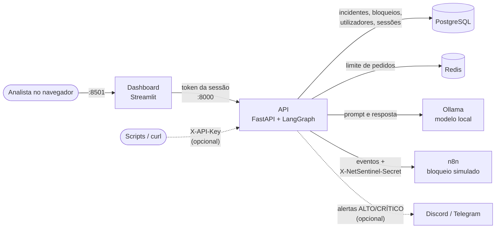

# NetSentinel

[](https://github.com/Peroba-7/netsentinel/actions/workflows/tests.yml)

Plataforma de triagem de incidentes de segurança com IA que corre localmente, sem enviar dados para serviços externos.
O analista submete um incidente, um modelo no Ollama classifica o risco (BAIXO a CRÍTICO) e escreve um parecer, e o resultado fica guardado com histórico, gráficos e resposta ao incidente.
O acesso é feito com login e perfis (leitor, analista, admin), e as permissões são aplicadas na própria API.

> [!WARNING]
> **O bloqueio de IPs é simulado.** Nenhuma firewall é alterada: o n8n apenas regista o pedido e responde `bloqueado (simulado)`. O projeto foi configurado para uso local; leia a secção [Segurança](#segurança) antes de expor qualquer serviço.

## Índice

- [Funcionalidades](#funcionalidades)
- [Arquitetura](#arquitetura)
- [Capturas de ecrã](#capturas-de-ecrã)
- [Perfis e permissões](#perfis-e-permissões)
- [Instalação no Windows](#instalação-no-windows)
- [Variáveis de ambiente](#variáveis-de-ambiente)
- [Bloqueio de IPs (simulado)](#bloqueio-de-ips-simulado)
- [API](#api)
- [Classificação de risco pela IA](#classificação-de-risco-pela-ia)
- [Desenvolvimento e testes](#desenvolvimento-e-testes)
- [Segurança](#segurança)
- [Próximos passos](#próximos-passos)
- [Licença](#licença)

Decisões de arquitetura e as suas razões: [docs/ARQUITETURA.md](docs/ARQUITETURA.md).

## Funcionalidades

**Análise**
- Classificação de risco por um modelo local (Ollama, `llama3` por omissão) em BAIXO, MÉDIO, ALTO ou CRÍTICO, com parecer técnico e ações recomendadas
- Critérios objetivos por nível e exemplos no prompt; respostas fora do formato ficam `INDETERMINADO`, em vez de um nível inventado
- Tipo de ameaça normalizado ao guardar (por exemplo, "SSH Brute Force" e "brute-force" contam como "Brute Force")

**Histórico e relatório**
- Métricas, gráficos por tipo e por nível de risco, filtros por risco e por texto
- Exportação para CSV protegida contra fórmulas (as descrições vêm de terceiros)

**Resposta a incidentes**
- Pedido de bloqueio de IP, permanente ou com prazo (30 min, 1 hora, 24 horas), enviado ao n8n, com o motivo preenchido a partir do incidente
- Desbloqueio manual e desbloqueio automático no fim do prazo, com nova tentativa se o n8n falhar
- Alertas de risco ALTO ou CRÍTICO no Discord e no Telegram (opcionais)

**Acesso**
- Login com perfis leitor, analista e admin, verificados na API em cada rota
- Gestão de utilizadores no dashboard (admin) e criação do primeiro admin pela linha de comandos
- Sessões com validade e botão Sair; bloqueio temporário do login após tentativas falhadas

**Operação**
- Docker Compose com todos os serviços; migrações da base de dados com Alembic, aplicadas no arranque
- Verificação do estado dos serviços em `/health`
- Testes automáticos (`pytest`) e análise estática (`ruff`) no GitHub Actions

## Arquitetura



| Componente | Função |
|---|---|
| **Dashboard** (Streamlit) | Ecrãs de login, histórico, submissão de incidentes e utilizadores. Não tem credenciais próprias: fala com a API com o token de quem entrou |
| **API** (FastAPI) | Autenticação, permissões por perfil, validação, análise e registo. Corre `alembic upgrade head` antes de arrancar |
| **LangGraph** | Orquestra o fluxo de análise; o Ollama é chamado com o cliente oficial `ollama` |
| **PostgreSQL** | Incidentes, bloqueios, utilizadores, sessões e tentativas de login |
| **Redis** | Limite de análises por minuto. Se estiver em baixo, o limite deixa de ser aplicado e a análise continua |
| **Ollama** | Executa o modelo de IA na própria máquina; só é acessível pela rede interna do Compose |
| **n8n** | Recebe os eventos da API. O workflow incluído trata o bloqueio e o desbloqueio simulados e confirma a receção dos restantes eventos |

**Fluxo de uma análise:** o dashboard envia o incidente à API com o token da sessão → a API confirma o perfil (analista ou admin) e o limite de pedidos → o LangGraph pede a classificação ao Ollama → a API guarda o incidente no PostgreSQL e responde → em segundo plano, envia o evento ao n8n e, se o risco for ALTO ou CRÍTICO, o alerta ao Discord/Telegram. Uma falha nos alertas não impede a análise.

```text
app/
├── agents/          Fluxo do LangGraph, prompt e leitura da resposta da IA
├── api/             Rotas /auth, /threats e /users
├── core/            Autenticação, perfis, hash de palavras-passe e limite de pedidos
├── db/              Ligação à base de dados e modelos
├── schemas/         Validação de entradas e respostas
├── services/        Ollama, notificações, utilizadores e sessões, tarefa periódica
├── cli.py           Criação de utilizadores pela linha de comandos
└── main.py          Aplicação FastAPI e /health
app_pages/           Páginas do dashboard (login, histórico, submissão, utilizadores)
evals/               Casos de avaliação da classificação de risco
migrations/          Migrações da base de dados (Alembic)
n8n/                 Workflow de bloqueio simulado e scripts de instalação
tests/               Testes automáticos
```

## Capturas de ecrã

Os dados nas capturas devem ser fictícios (use IPs de documentação, como `203.0.113.x`).

> 📷 **PRINT 1 — Ecrã de login.** Ecrã "Iniciar sessão", sem nenhuma página de dados visível.
> Ficheiro sugerido: `docs/img/01-login.png`

> 📷 **PRINT 2 — Histórico (perfil admin).** Métricas, gráficos "Ameaças por tipo" e "Níveis de risco", tabela de incidentes com a coluna "IP bloqueado", e a barra lateral com o utilizador, o perfil e o botão Sair.
> Ficheiro sugerido: `docs/img/02-historico.png`

> 📷 **PRINT 3 — Submeter incidente.** Formulário preenchido e o resultado: nível de risco, estado e parecer da IA.
> Ficheiro sugerido: `docs/img/03-submeter.png`

> 📷 **PRINT 4 — Resposta a incidentes.** Escolha do IP e da duração do bloqueio, aviso de modo de simulação e tabela "Bloqueios ativos" com a coluna "expira em".
> Ficheiro sugerido: `docs/img/04-bloqueios.png`

> 📷 **PRINT 5 — Mesmo ecrã com perfil leitor.** O histórico sem os botões de bloqueio e desbloqueio, e o menu só com "Histórico".
> Ficheiro sugerido: `docs/img/05-leitor.png`

> 📷 **PRINT 6 — Utilizadores (admin).** Lista de utilizadores e os separadores "Criar utilizador" e "Alterar utilizador".
> Ficheiro sugerido: `docs/img/06-utilizadores.png`

> 📷 **PRINT 7 — Documentação da API.** Swagger em `http://localhost:8000/docs`, com as rotas `/auth`, `/threats` e `/users`.
> Ficheiro sugerido: `docs/img/07-swagger.png`

## Perfis e permissões

As permissões são verificadas **na API**, em cada rota. O dashboard só esconde os botões e as páginas que o perfil não pode usar; quem chamar a API diretamente recebe `403` nas ações não permitidas.

| Ação | Rota da API | leitor | analista | admin |
|---|---|:-:|:-:|:-:|
| Ver histórico, gráficos e bloqueios | `GET /threats/`, `GET /threats/{id}`, `GET /threats/blocked` | ✅ | ✅ | ✅ |
| Submeter incidente para análise | `POST /threats/analyze` | ❌ | ✅ | ✅ |
| Pedir bloqueio de IP | `POST /threats/block` | ❌ | ✅ | ✅ |
| Retirar bloqueio | `DELETE /threats/block/{ip}` | ❌ | ❌ | ✅ |
| Listar, criar e alterar utilizadores | `/users/` | ❌ | ❌ | ✅ |

No dashboard, o menu mostra só as páginas do perfil: o leitor vê "Histórico"; o analista também "Submeter incidente"; o admin também "Utilizadores". O sistema não permite retirar o último admin ativo.

A **chave de serviço** (`API_KEY`, opcional) tem acesso de admin e serve para scripts. Só o contentor da API a recebe.

## Instalação no Windows

### Requisitos

- Windows 10 ou 11 com [Docker Desktop](https://www.docker.com/products/docker-desktop/) (motor WSL 2)
- [Git para Windows](https://git-scm.com/download/win)
- Cerca de 8 GB de memória disponível para o Docker com `llama3` e 15 GB livres em disco
- Python só é necessário para desenvolvimento fora do Docker

Os comandos abaixo são para o **PowerShell**, na pasta do projeto.

### 1. Obter o código

```powershell
git clone https://github.com/Peroba-7/netsentinel.git
cd netsentinel
```

### 2. Criar o `.env`

```powershell
Copy-Item .env.example .env
```

Gere um segredo aleatório (64 caracteres hexadecimais) com este comando. Corra-o uma vez por cada segredo, para que todos sejam diferentes:

```powershell
$b = New-Object byte[] 32; [Security.Cryptography.RandomNumberGenerator]::Create().GetBytes($b); -join ($b | ForEach-Object { $_.ToString("x2") })
```

Abra o ficheiro com `notepad .env` e preencha:

| Variável | Valor |
|---|---|
| `POSTGRES_PASSWORD` | Um segredo gerado (só letras e números) |
| `DATABASE_URL` | Substitua `ALTERAR` pelo mesmo valor; é usado fora do Docker |
| `N8N_WEBHOOK_SECRET` | Outro segredo gerado; sem ele, os pedidos de bloqueio são recusados |
| `API_KEY` | Opcional: outro segredo, só se for usar scripts ou `curl` sem login |

Guarde o ficheiro em UTF-8 no Bloco de Notas. Não acrescente linhas com `>>` no PowerShell 5.1: grava em UTF-16 e estraga o ficheiro. O `.env` guarda segredos e nunca deve entrar no git (já está no `.gitignore`).

### 3. Subir os serviços

```powershell
docker compose up -d --build
docker compose ps
```

Ao arrancar, a API aplica as migrações da base de dados. Na primeira execução, o serviço `ollama-pull` descarrega o modelo, o que pode demorar vários minutos; quando acaba, aparece como `Exited`, o que é normal.

### 4. Criar o primeiro admin

O dashboard só abre com login. A palavra-passe (mínimo de 12 caracteres) é pedida no terminal, sem aparecer no ecrã, e não fica guardada em nenhum ficheiro:

```powershell
docker exec -it netsentinel-api python -m app.cli create-user admin --role admin
```

Os outros utilizadores são criados por esse admin, na página **Utilizadores**. Para repor uma palavra-passe esquecida (termina as sessões abertas dessa conta):

```powershell
docker exec -it netsentinel-api python -m app.cli set-password admin
```

### 5. Instalar o workflow do n8n

O script lê o `N8N_WEBHOOK_SECRET` do `.env`, importa o workflow e a credencial, e publica o workflow:

```powershell
powershell -ExecutionPolicy Bypass -File .\n8n\install-workflow.ps1
```

O `-ExecutionPolicy Bypass` aplica-se só a este comando; é necessário porque o Windows bloqueia scripts por omissão. Se mudar o `N8N_WEBHOOK_SECRET`, corra o script de novo e reinicie a API com `docker compose up -d`.

### 6. Abrir

| Serviço | Endereço |
|---|---|
| Dashboard | http://localhost:8501 |
| Documentação da API (Swagger) | http://localhost:8000/docs |
| n8n | http://localhost:5678 |

Confirme que os serviços estão ligados (no PowerShell 5.1, `curl` é outro comando; use `curl.exe`):

```powershell
curl.exe http://localhost:8000/health
```

A resposta indica o estado da base de dados, do Redis e do Ollama. Todas as portas só aceitam ligações desta máquina (`127.0.0.1`).

**Linux e macOS:** os passos são os mesmos, com `cp .env.example .env`, `python -c "import secrets; print(secrets.token_hex(32))"` para gerar segredos e `./n8n/install-workflow.sh` no passo 5.

## Variáveis de ambiente

Todas estão em [.env.example](.env.example). O contentor do dashboard só recebe `API_URL` e `OLLAMA_TIMEOUT_SECONDS`.

| Variável | Obrigatória | Descrição |
|---|---|---|
| `POSTGRES_USER`, `POSTGRES_PASSWORD`, `POSTGRES_DB` | Com Docker | Credenciais do PostgreSQL |
| `DATABASE_URL` | Sim | Ligação ao PostgreSQL; no Docker, o Compose monta-a a partir das variáveis acima |
| `API_KEY` | Não | Chave de serviço com acesso total, para scripts (mínimo de 16 caracteres). Vazia, fica desativada |
| `SESSION_TTL_MINUTES` | Não | Validade de uma sessão de login; predefinido 480 (8 horas) |
| `LOGIN_MAX_ATTEMPTS` | Não | Tentativas falhadas antes do bloqueio do login; predefinido 5 |
| `LOGIN_LOCK_MINUTES` | Não | Duração do bloqueio do login; predefinido 15 |
| `REDIS_URL` | Não | Ligação ao Redis |
| `RATE_LIMIT_PER_MINUTE` | Não | Análises por cliente, por minuto; predefinido 10, 0 desativa |
| `OLLAMA_URL` | Não | Endereço do Ollama |
| `OLLAMA_MODEL` | Não | Modelo de IA; predefinido `llama3` |
| `OLLAMA_TIMEOUT_SECONDS` | Não | Tempo máximo de resposta do modelo; predefinido 300 |
| `BLOCK_EXPIRY_INTERVAL_SECONDS` | Não | Intervalo da tarefa que retira bloqueios vencidos e limpa sessões antigas; predefinido 60, 0 desativa |
| `N8N_WEBHOOK_URL` | Não | Webhook do n8n que recebe os eventos |
| `N8N_WEBHOOK_SECRET` | Com n8n | Segredo enviado no cabeçalho `X-NetSentinel-Secret`; o webhook recusa pedidos sem ele |
| `DISCORD_WEBHOOK_URL` | Não | Alertas de risco ALTO e CRÍTICO no Discord |
| `TELEGRAM_BOT_TOKEN`, `TELEGRAM_CHAT_ID` | Não | Alertas de risco ALTO e CRÍTICO no Telegram |
| `API_URL` | Dashboard | Endereço da API usado pelo dashboard |

## Bloqueio de IPs (simulado)

> [!IMPORTANT]
> **Nenhuma firewall é alterada.** O nó "Firewall (SIMULADO)" do workflow do n8n só regista o pedido no log e responde `bloqueado (simulado)`. O dashboard mostra "Sim (simulado)" e um aviso de modo de simulação.

1. Um analista ou admin pede o bloqueio no dashboard (ou em `POST /threats/block`), escolhendo a duração.
2. A API regista o pedido e envia o evento `ip.block` ao n8n, com o motivo (por exemplo, `Brute Force, risco ALTO`).
3. O n8n valida o IP e responde `bloqueado (simulado)`; a API guarda essa resposta.
4. No histórico, todos os incidentes desse IP mostram "IP bloqueado: Sim (simulado)". O estado de cada incidente continua `ANALISADO`, porque o bloqueio é do IP e não do incidente.

Se o n8n não aceitar o pedido, o IP fica como "não enviado" e o pedido pode ser repetido. Um desbloqueio, manual ou no fim do prazo, só remove o registo se o n8n o aceitar, para a API nunca indicar como livre um IP que pode continuar bloqueado. Se falhar, o bloqueio mantém-se registado: o desbloqueio manual devolve um erro e pode ser repetido, e o do fim do prazo é tentado de novo pela tarefa periódica no minuto seguinte.

Eventos que o webhook recebe:

```json
{"event": "threat.analyzed", "id": 1, "ip_address": "203.0.113.7", "risk_level": "ALTO", "...": "..."}
{"event": "ip.block", "ip_address": "203.0.113.7", "reason": "Brute Force, risco ALTO"}
{"event": "ip.unblock", "ip_address": "203.0.113.7"}
```

Para ver os bloqueios simulados: `docker logs netsentinel-n8n 2>&1 | Select-String NETSENTINEL-BLOCK` (no Linux, `| grep NETSENTINEL-BLOCK`).

**Para usar uma firewall real**, só o nó "Firewall (SIMULADO)" tem de mudar: por exemplo, para um nó SSH que execute `ufw` ou `iptables` no servidor (o n8n corre num contentor, por isso um comando local não afetaria o servidor), seguido de um nó que responda com `status` igual a `bloqueado`. Mantenha o nó "Validar IP", que impede a injeção de comandos, use uma conta SSH só com essas permissões e teste primeiro com um IP inofensivo. Os bloqueios já aceites em simulação não são reenviados: retire-os e peça-os de novo.

## API

Documentação interativa em **http://localhost:8000/docs**.

**Autenticação.** Pessoas usam sessões: `POST /auth/login` devolve um `token`, enviado depois em `Authorization: Bearer <token>`; `POST /auth/logout` invalida-o. Scripts podem usar a chave de serviço no cabeçalho `X-API-Key`.

| Método | Rota | Perfil mínimo | Descrição |
|---|---|---|---|
| `GET` | `/`, `/health` | Público | API ativa; estado da base de dados, do Redis e do Ollama |
| `POST` | `/auth/login` | Público | Inicia sessão; devolve o token, o perfil e a validade |
| `POST` | `/auth/logout` | Qualquer sessão | Termina a sessão |
| `GET` | `/auth/me` | Qualquer sessão | Utilizador e perfil da sessão |
| `GET` | `/threats/` | leitor | Lista incidentes (`limit`, `offset`, filtros `risk_level`, `ip_address` e `search`) |
| `GET` | `/threats/{id}` | leitor | Devolve um incidente |
| `GET` | `/threats/blocked` | leitor | Lista os IPs com bloqueio pedido |
| `POST` | `/threats/analyze` | analista | Analisa e guarda um incidente |
| `POST` | `/threats/block` | analista | Pede um bloqueio; `duration_minutes` (1 a 10080) opcional |
| `DELETE` | `/threats/block/{ip}` | admin | Retira um bloqueio |
| `GET`, `POST` | `/users/` | admin | Lista e cria utilizadores |
| `PATCH` | `/users/{id}` | admin | Altera perfil, estado ou palavra-passe |

**Exemplo no PowerShell** (o `Get-Credential` pede o utilizador e a palavra-passe sem mostrar a palavra-passe nem a guardar no histórico):

```powershell
$cred = Get-Credential
$body = @{ username = $cred.UserName; password = $cred.GetNetworkCredential().Password } | ConvertTo-Json
$session = Invoke-RestMethod -Method Post -Uri http://localhost:8000/auth/login -ContentType "application/json" -Body $body
$headers = @{ Authorization = "Bearer $($session.token)" }

Invoke-RestMethod -Method Post -Uri http://localhost:8000/threats/analyze -Headers $headers -ContentType "application/json" `
  -Body '{"ip_address": "203.0.113.7", "threat_type": "Brute Force", "description": "500 failed SSH logins in 2 minutes against root."}'
```

O mesmo com `curl` no Linux ou no Git Bash:

```bash
read -s -p "Palavra-passe: " PASS; echo
TOKEN=$(curl -s -X POST http://localhost:8000/auth/login -H "Content-Type: application/json" \
  -d "{\"username\": \"ana\", \"password\": \"$PASS\"}" | python -c "import json,sys; print(json.load(sys.stdin)['token'])")
unset PASS

curl -X POST http://localhost:8000/threats/analyze \
  -H "Authorization: Bearer $TOKEN" -H "Content-Type: application/json" \
  -d '{"ip_address": "203.0.113.7", "threat_type": "Brute Force", "description": "500 tentativas de login SSH falhadas em 2 minutos contra a conta root."}'
```

| Código | Significado |
|---|---|
| `201` | Incidente analisado e guardado |
| `401` | Sem sessão, sessão expirada ou chave de serviço inválida |
| `403` | O perfil não tem permissão para esta ação |
| `422` | Dados inválidos, por exemplo um IP incorreto |
| `429` | Limite de análises excedido, ou login bloqueado por tentativas falhadas |
| `503` | Modelo de IA indisponível; nada é guardado |

## Classificação de risco pela IA

O prompt ([app/agents/prompt.py](app/agents/prompt.py)) define critérios por nível (número de tentativas, sucesso depois de falhas, conta privilegiada, origem conhecida), trata o campo "Tipo" como suspeita e não como conclusão, e inclui quatro exemplos curtos, um deles benigno. O texto do incidente vai entre delimitadores `<incidente>`, e o modelo é instruído a não seguir instruções que apareçam lá dentro.

[evals/incidents.json](evals/incidents.json) tem 10 incidentes com o nível esperado. Os testes usam-nos com o Ollama simulado; para medir o modelo real (sem gravar incidentes nem enviar alertas):

```powershell
docker cp evals netsentinel-api:/tmp/evals
docker exec -w /app -e PYTHONPATH=/app netsentinel-api python /tmp/evals/run_live.py /tmp/evals/incidents.json --repeat 3
```

Resultado com `llama3`, só com CPU (novembro de 2026): os 10 casos corretos numa passagem; nos três casos reais repetidos três vezes, 8 de 9 corretos (um DDoS saiu CRÍTICO em vez de ALTO). Com o prompt anterior, um login benigno ("errou a senha duas vezes e entrou a partir do escritório") saía MÉDIO nas três repetições; agora sai BAIXO. A amostra é pequena e o modelo pode errar: a classificação apoia a decisão do analista, não a substitui.

Numa comparação anterior com dois incidentes, o `gemma:2b` respondeu em 6 a 8 s e o `llama3` em 42 a 67 s (CPU, com o modelo carregado), mas só o `llama3` distinguiu os dois incidentes. Para trocar de modelo, altere `OLLAMA_MODEL` e corra `docker compose up -d`.

## Desenvolvimento e testes

Com o PostgreSQL e o Ollama acessíveis (por exemplo, os do Docker):

```powershell
python -m venv venv
venv\Scripts\activate
pip install -r requirements-dev.txt

alembic upgrade head
python -m app.cli create-user admin --role admin    # só da primeira vez
uvicorn app.main:app --reload                       # API
streamlit run dashboard.py                          # dashboard, noutro terminal
```

```powershell
pytest
ruff check .
```

Os testes usam uma base de dados SQLite em memória e simulam o Ollama, o n8n e a API (no caso do dashboard), por isso não precisam do Docker. Cobrem, entre outros: login certo e errado, bloqueio por tentativas, sessões expiradas e terminadas, o que cada perfil pode fazer em cada rota, o que cada perfil vê no dashboard, as migrações face aos modelos, a expiração dos bloqueios e a leitura das respostas da IA. O GitHub Actions corre `ruff` e `pytest` em cada push.

**Migrações.** O esquema é gerido pelo Alembic (`migrations/versions/`). Depois de alterar um modelo em `app/db/models.py`:

```powershell
alembic revision --autogenerate -m "descricao curta" --rev-id 0004
alembic upgrade head
```

Reveja o ficheiro gerado antes de o aplicar, e faça uma cópia de segurança antes de migrar dados reais:

```powershell
docker exec netsentinel-postgres sh -c 'pg_dump -U "$POSTGRES_USER" "$POSTGRES_DB"' > backup.sql
```

No PowerShell 5.1, o `>` grava em UTF-16; para um ficheiro UTF-8, use o Git Bash ou o PowerShell 7. Os ficheiros `backup*.sql` estão no `.gitignore`.

## Segurança

### O que foi feito

- **Permissões na API.** Cada rota exige um perfil mínimo; o dashboard não tem nenhuma chave mestra e usa o token de quem entrou. Sem sessão a API responde `401`; sem permissão, `403`.
- **Palavras-passe** guardadas só como hash argon2id (mínimo de 12 caracteres). O primeiro admin é criado pela linha de comandos, com a palavra-passe pedida no terminal.
- **Sessões** com token aleatório, guardado na base de dados só como hash SHA-256, com validade configurável. Sair, desativar a conta ou trocar a palavra-passe invalida as sessões.
- **Login sem revelar contas.** A mesma mensagem para utilizador inexistente, desativado ou palavra-passe errada, e um tempo de resposta equivalente (quando a conta não existe, é verificado um hash falso com o mesmo custo). As tentativas contam por nome, exista a conta ou não, e bloqueiam o login durante 15 minutos depois de 5 falhas.
- **Contentor do dashboard sem credenciais.** Não recebe a `API_KEY`, a palavra-passe do PostgreSQL nem os segredos do n8n e dos alertas.
- **Portas só em `127.0.0.1`**; o Ollama só é acessível pela rede interna do Compose.
- **Webhook do n8n autenticado** com o cabeçalho `X-NetSentinel-Secret`; o IP é validado antes de chegar ao nó da firewall.
- **Dados não confiáveis tratados como tal:** delimitadores no prompt da IA, CSV exportado sem fórmulas e alertas do Discord sem menções.
- **Segredos fora do repositório:** `.env` e cópias de segurança no `.gitignore` e no `.dockerignore`; o `alembic.ini` lê a ligação das configurações.

### Limitações conhecidas

- **Sem HTTPS.** Palavras-passe, tokens e o segredo do webhook viajam sem cifra entre os serviços. Na configuração atual, isso só acontece dentro desta máquina.
- **Bloqueio de IPs simulado.** Ligar uma firewall real exige alterar o workflow do n8n e testar com cuidado.
- **Bloqueio do login por nome.** Alguém pode bloquear de propósito o login de outra pessoa durante 15 minutos.
- **Chave de serviço com acesso total.** Se for usada, quem a tiver é admin; deixe-a vazia se não for necessária.
- **Sessão do dashboard por separador.** Recarregar a página (F5) pede login de novo.
- **Limite de análises por IP.** Todos os utilizadores do dashboard partilham o mesmo IP de origem, e por isso o mesmo limite. Se o Redis falhar, o limite deixa de ser aplicado.
- **Sem registo de auditoria** de quem pediu cada bloqueio ou alterou cada utilizador.
- **Manipulação da IA.** As instruções e os delimitadores reduzem o risco de um incidente manipular o modelo, mas não o eliminam. O bloqueio é sempre uma decisão humana: a classificação nunca bloqueia um IP sozinha.
- **Uma tarefa por processo.** A tarefa periódica corre dentro da API; com vários workers do `uvicorn`, cada um teria a sua.

Antes de usar fora desta máquina: coloque os serviços atrás de um proxy com HTTPS, mantenha as portas fechadas ao exterior e use segredos fortes e exclusivos em todas as variáveis.

## Próximos passos

- [ ] Integração com uma firewall real (`ufw` ou `iptables`)
- [ ] Proxy com HTTPS
- [ ] Registo de auditoria e troca da própria palavra-passe
- [ ] Fluxo do LangGraph com mais etapas, como enriquecimento de IPs
- [ ] Avaliação dos modelos com um conjunto maior de incidentes
- [ ] Versões fixas das imagens do Ollama e do n8n, e aceleração por GPU

## Licença

Distribuído sob a licença MIT. Consulte o ficheiro [LICENSE](LICENSE).
