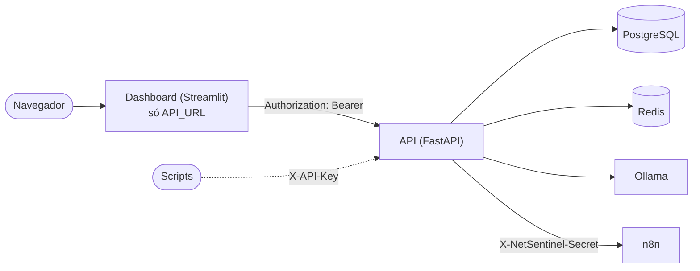

# Decisões de arquitetura

Este documento explica as principais decisões técnicas do NetSentinel: o problema que cada uma resolve, a alternativa considerada e o custo da escolha. O funcionamento e a instalação estão no [README](../README.md).

## Visão geral



A API é o único componente que fala com a base de dados, com o modelo de IA e com o n8n, e é também o único que decide quem pode fazer o quê. O dashboard é apenas uma interface.

---

## 1. As permissões são aplicadas na API, não só no dashboard

**Problema.** Na primeira versão, o dashboard falava com a API usando uma chave partilhada (`API_KEY`) com acesso total. Esconder botões no dashboard conforme o perfil não protegeria nada: um erro no código das páginas, ou qualquer pessoa com acesso à chave ou ao contentor do dashboard, conseguiria fazer todas as ações chamando a API diretamente.

**Decisão.** Cada rota da API declara o perfil mínimo de que precisa, com uma dependência do FastAPI (`require_role` em [app/core/security.py](../app/core/security.py)):

```python
router = APIRouter(prefix="/threats", dependencies=[Depends(require_role("leitor"))])

@router.delete("/block/{ip_address}", dependencies=[Depends(require_role("admin"))])
def unblock_ip(...): ...
```

Os perfis são cumulativos (leitor < analista < admin). A dependência identifica quem fez o pedido a partir do token da sessão (`Authorization: Bearer`) ou da chave de serviço (`X-API-Key`), e responde:

- `401` quando não há credencial válida (sem sessão, sessão expirada, conta desativada, chave errada);
- `403` quando a pessoa está autenticada mas o perfil não chega.

O dashboard também esconde o que o perfil não pode usar (menu, botões, páginas), mas isso serve só para não mostrar ecrãs que dariam erro. A regra que conta é a da API. Nas ações de alterar dados, o perfil é verificado antes do limite de pedidos, para pedidos recusados não gastarem a quota.

**Como é testado.** Um teste percorre todas as combinações de perfil e rota protegida e confirma que a API deixa passar ou responde `403` conforme a tabela de permissões, e que todas respondem `401` sem sessão ([tests/test_auth.py](../tests/test_auth.py)).

**Alternativas consideradas.**

| Opção | Proteção real | Custo |
|---|---|---|
| Só esconder botões no dashboard | Nenhuma: a chave mestra continua a permitir tudo | Baixo |
| **Perfis verificados na API** (escolhida) | Vale para qualquer cliente, incluindo chamadas diretas | Tabelas de utilizadores e sessões, rotas de login, uma dependência por rota e uma consulta extra à base de dados por pedido |

### Sessões guardadas na base de dados, e não JWT

O token de sessão é um valor aleatório (`secrets.token_urlsafe(32)`) e a base de dados guarda apenas o seu hash SHA-256, com a data de expiração. Um JWT evitaria a consulta à base de dados, mas não pode ser revogado antes de expirar. Com sessões na base de dados:

- o botão **Sair** invalida o token imediatamente;
- desativar uma conta ou trocar a palavra-passe termina as sessões dessa conta;
- quem ler a tabela `user_sessions` não consegue usar os tokens, porque só tem os hashes.

O custo é uma consulta por pedido, irrelevante para o volume deste projeto.

### Palavras-passe e tentativas de login

- As palavras-passe são guardadas como hash **argon2id** (biblioteca `argon2-cffi`, parâmetros predefinidos).
- O primeiro admin é criado por `python -m app.cli create-user`, que pede a palavra-passe no terminal sem eco. Assim, ela nunca passa por argumentos da linha de comandos, pelo `.env` ou pelo código.
- As tentativas falhadas contam **por nome de utilizador, exista a conta ou não**, numa tabela própria (`login_attempts`). Se só se contassem as falhas de contas existentes, o bloqueio ao fim de 5 tentativas revelaria quais nomes existem.
- Quando a conta não existe, está desativada ou o nome está bloqueado, a API verifica mesmo assim um hash falso, para o tempo de resposta não denunciar a diferença. A mensagem é sempre a mesma.
- **Custo assumido:** alguém pode bloquear de propósito o login de outra pessoa durante 15 minutos. O bloqueio é temporário para limitar esse efeito.

O contador fica na base de dados, e não no Redis, porque o limite de pedidos do Redis deixa passar tudo quando o Redis falha. Para uma proteção de login, falhar dessa forma não é aceitável.

### Chave de serviço

A `API_KEY` continua a existir para scripts e integrações, com acesso de admin. É opcional (vazia, fica desativada) e só o contentor da API a recebe. Uma chave enviada e errada é recusada, mesmo que o pedido traga também um token válido.

---

## 2. O esquema da base de dados é gerido por migrações (Alembic)

**Problema.** A API criava as tabelas ao arrancar com `SQLModel.metadata.create_all()`. Esse método só cria tabelas que ainda não existem; não adiciona colunas a tabelas existentes. A primeira alteração de esquema numa base já em uso (a coluna `expires_at` dos bloqueios com prazo) teria deixado o código e a base de dados desalinhados, com erros só em produção.

**Decisão.** O esquema passou a ser definido por migrações do Alembic em [migrations/versions/](../migrations/versions/), aplicadas por ordem:

| Migração | Alteração |
|---|---|
| `0001` | Tabelas iniciais `threat_records` e `blocked_ips` |
| `0002` | Coluna opcional `expires_at` em `blocked_ips` |
| `0003` | Tabelas `users`, `user_sessions` e `login_attempts` |

Pormenores importantes:

- **Adoção sem perder dados.** A migração `0001` só cria cada tabela se ela ainda não existir. Numa base criada antes do Alembic, não altera nada e fica apenas registada como aplicada.
- **Aplicadas antes de a API arrancar.** O contentor da API corre `alembic upgrade head && exec uvicorn ...`. Se uma migração falhar, a API não arranca, em vez de funcionar com um esquema errado. A API já não cria tabelas.
- **Sem segredos no `alembic.ini`.** O ambiente do Alembic ([migrations/env.py](../migrations/env.py)) lê o `DATABASE_URL` das mesmas configurações da aplicação.
- **Tabelas antigas protegidas.** Tabelas que não pertencem aos modelos (como a antiga `threat_logs`) são ignoradas pelo `--autogenerate`, que de outra forma proporia apagá-las.
- **Migrações coerentes com o código.** Um teste aplica todas as migrações a uma base vazia e compara o resultado com os modelos; se alguém alterar um modelo e esquecer a migração, o teste falha. Outro teste confirma que a `0001` preserva os dados de uma base existente ([tests/test_migrations.py](../tests/test_migrations.py)).

**Custo.** Cada alteração aos modelos exige também uma migração revista à mão, e aplicar migrações a dados reais pede uma cópia de segurança antes.

---

## 3. O contentor do dashboard não recebe credenciais

**Problema.** No Docker Compose, a API e o dashboard partilhavam a mesma configuração (`env_file: .env`). O contentor do dashboard recebia, portanto, a chave mestra da API, a palavra-passe do PostgreSQL e os segredos do n8n e dos alertas, embora não precise de nenhum deles. Com as permissões já aplicadas na API, isso seria a forma mais simples de as contornar: quem comprometesse o dashboard ficaria com acesso total.

**Decisão.** Aplicar o princípio do menor privilégio. O serviço `dashboard` do [docker-compose.yml](../docker-compose.yml) não usa o `env_file` e recebe apenas o que precisa:

```yaml
dashboard:
  environment:
    API_URL: http://api:8000
    OLLAMA_TIMEOUT_SECONDS: ${OLLAMA_TIMEOUT_SECONDS:-300}
```

Para isso:

- a `API_KEY` e o `DATABASE_URL` tornaram-se opcionais nas configurações partilhadas ([app/config.py](../app/config.py)), para o dashboard poder arrancar sem eles. A API continua a exigir o `DATABASE_URL` e falha ao arrancar se ele faltar;
- o dashboard não importa nada da camada de base de dados e fala com a API só com o token da pessoa que entrou ([dashboard_api.py](../dashboard_api.py));
- o `.env` também está no `.dockerignore`, por isso não é copiado para a imagem.

**Resultado.** Se o contentor do dashboard for comprometido, quem lá estiver tem apenas o endereço da API e as sessões de quem estiver a usá-lo nesse momento, limitadas ao perfil de cada pessoa e à validade da sessão.

**Custo.** O dashboard não pode ler dados diretamente da base de dados nem fazer nada sem uma sessão. Neste projeto isso não é uma limitação, porque tudo passa pela API.

---

## Outras decisões

### Bloqueio através do n8n, com confirmação

A API não altera nenhuma firewall; pede a ação ao n8n e guarda o que ele responder (`dispatched` e `result`). Isto isola a parte perigosa (executar comandos num servidor) num workflow que pode ser trocado sem mudar a API. As regras seguem um princípio: **a API nunca indica um estado que não foi confirmado.**

- Um bloqueio que o n8n não aceitou fica como "não enviado", e o incidente não aparece como bloqueado.
- Um desbloqueio só remove o registo se o n8n o aceitar; senão o IP continua a aparecer como bloqueado, porque pode estar.
- No fim do prazo, a mesma regra aplica-se, e a tarefa periódica tenta de novo no minuto seguinte.

### Tarefa periódica dentro da API

A expiração dos bloqueios e a limpeza de sessões e tentativas antigas correm numa tarefa `asyncio` iniciada com a API, a cada minuto, sem um agendador externo (Celery, cron). É simples e suficiente com um processo. O custo: com vários workers do `uvicorn`, cada um teria a sua tarefa, e seria preciso passar para um agendador único.

### IA local e respostas validadas

O modelo corre no Ollama, na própria máquina, para as descrições dos incidentes não saírem da infraestrutura. A resposta tem de ser JSON com um nível válido; qualquer outra coisa fica `INDETERMINADO`, em vez de se adivinhar um nível a partir do texto. O incidente vai entre delimitadores `<incidente>` que o próprio texto não consegue fechar. A classificação nunca bloqueia um IP sozinha: o bloqueio é sempre pedido por uma pessoa com perfil de analista ou admin.
